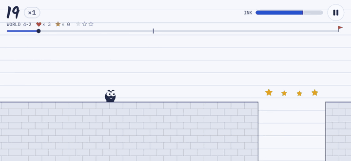
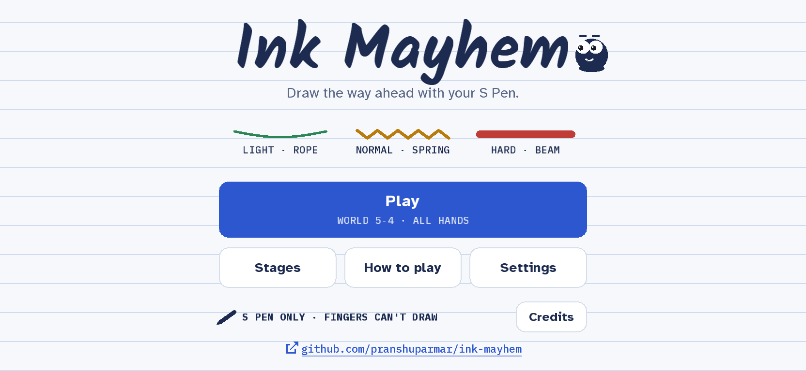
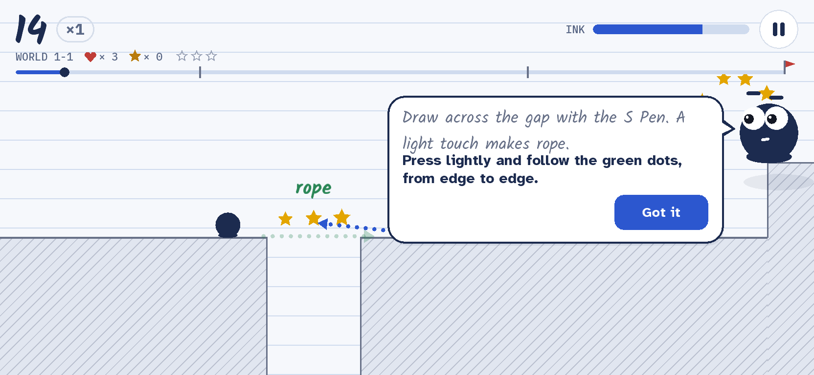
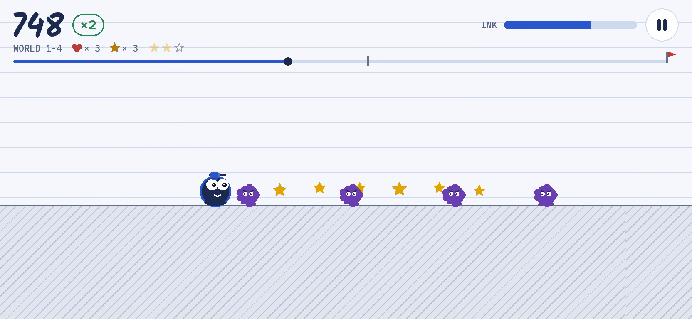
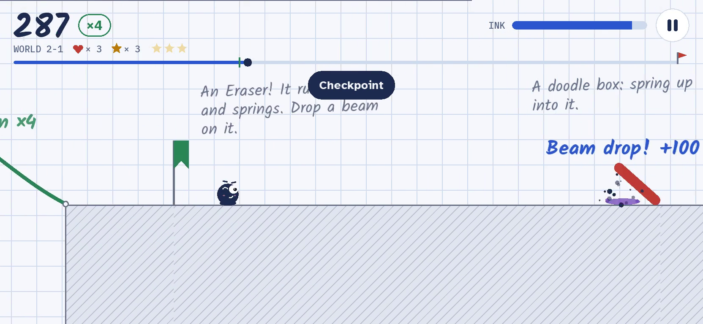
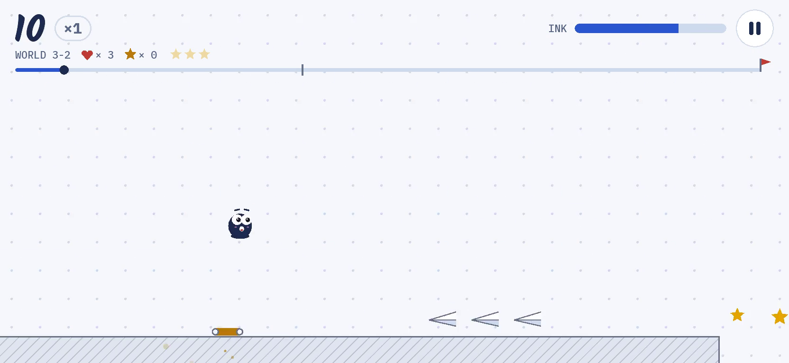
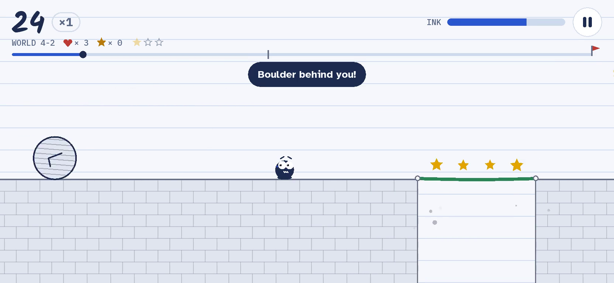
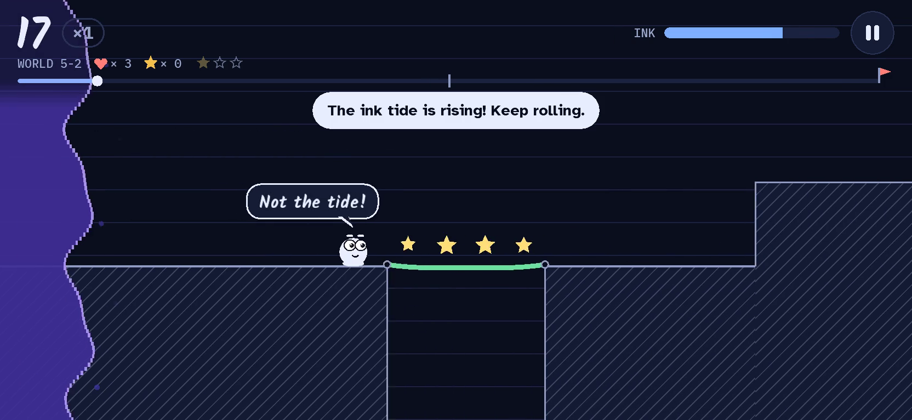
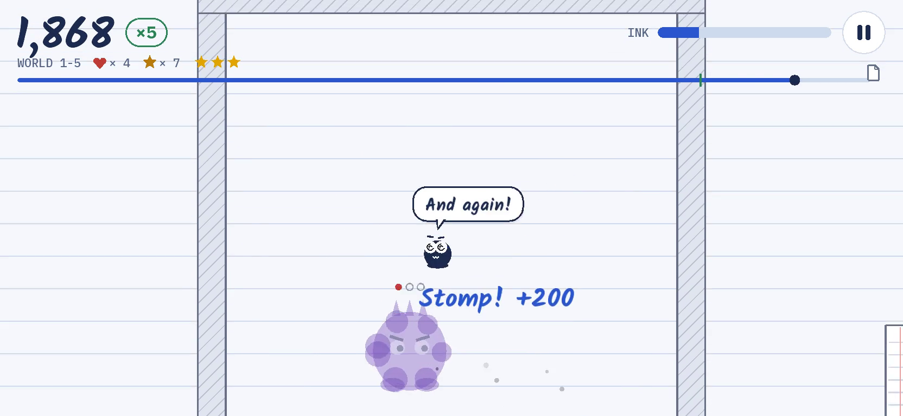
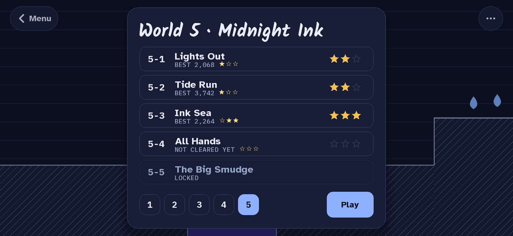

# Ink Mayhem

**Draw the way ahead.** An S Pen game for Galaxy phones and tablets: Dot, a drop of ink with
googly eyes, rolls across a notebook page, and you draw what's in front of it. How hard you
press decides what your ink becomes.

  

  <b><a href="https://github.com/pranshuparmar/ink-mayhem/releases/latest">⬇ DOWNLOAD THE APK: free, for Android with an S Pen</a></b> 
  No ads, no account, plays offline · S Pen only: fingers tap buttons but never draw · Android 9 or newer

## How it plays

You never steer Dot. It rolls by itself, and the only thing you control is the ink:

| Press | Ink | |
|---|---|---|
| Light touch | **Rope** | Nearly free. Holds Dot, lets boulders drop through, snaps over long gaps. |
| Normal writing | **Spring** | Bounces Dot (and boulders) high. Fatal under a spiked ceiling. |
| Press hard | **Beam** | Spans anything and carries anything, but costs far more ink. |

Use the lightest ink that works and your combo grows. Hold the S Pen's side button and touch a
stroke to erase it (you get half its ink back). Hover to see where the nib will land.

## What's in it

- 📖 **25 hand-built stages in five worlds**: The Notebook, The Cellar, Up High, The Castle and
  Midnight Ink. Each stage has lives, a checkpoint, the next page to reach and up to three stars.
- 👾 **A page that fights back**: Blots to bounce on, Erasers that rub out your ink, paper planes,
  ink beetles that eat rope, rolling boulders, crumbling bricks, ink pools and a rising ink tide.
- 👑 **A boss at the end of every world**, each beaten with something that world taught you.
- ✨ **Power-ups that change your ink**: the marker cap makes Dot Bold, the Highlighter finds
  hidden things, Cloud chalk floats where you draw it, the Gold nib's ink is free and unbreakable,
  and the Star nib makes Dot untouchable.
- ⭐ **Three hidden gold stars a stage**: at the top of a risky bounce, on a high road, down an
  inkwell or only under a highlighter.
- 🫧 **Dot has a personality**: it grins off a spring, wobbles on rope, sweats with a boulder
  behind, watches your pen while you draw and dozes off if you keep it waiting.
- 🙋 **Dot teaches, too**: the first time you play, it learns how *you* press (three lines:
  light, normal, hard) and walks you through rope, springs, beams and erasing. On each world's
  first stage it steps out of the page to show you what's new and exactly what to draw.
- 🎵 **An original chiptune theme for every world**, plus one for the bosses. All of it is made
  by the game's own code.
- 🏁 **A real ending**: beat the last boss and your notebook is tallied before the credits roll.
- 🤔 **Ask Dot when you're stuck**: from the pause card (or by itself after two falls in the same
  spot), Dot dots in the next strokes, in their ink's colour. Free, and it never plays for you.
- 📒 **Your Notebook**: lifetime stats, a book of 16 stickers to earn, the pages you tear out
  mid-stage and the result cards you share, and a jukebox that unlocks a world's tune when you
  beat its boss.
- 🖍️ **Doodle mode**, once you've seen the ending: endless ink, half speed, always Bold, and every
  power-up held for as long as you like.

Want the details? **[Read the full tour →](docs/FEATURES.md)**

## Screenshots

<table>
  <tr>
    <td width="33%"> The title screen</td>
    <td width="33%"> Dot shows you what to draw</td>
    <td width="33%"> The Notebook</td>
  </tr>
  <tr>
    <td width="33%"> The Cellar</td>
    <td width="33%"> Up High</td>
    <td width="33%"> The Castle</td>
  </tr>
  <tr>
    <td width="33%"> Midnight Ink</td>
    <td width="33%"> A boss fight</td>
    <td width="33%"> The stage list</td>
  </tr>
</table>

## Install

Ink Mayhem isn't on Google Play. Install it from an APK:

1. On the phone, open the [latest release](https://github.com/pranshuparmar/ink-mayhem/releases/latest) and download
   `ink-mayhem-*.apk` under **Assets**.
2. Open it. When Android asks, allow your browser (or Files) to install unknown apps, then
   install.

It needs a phone or tablet with an S Pen (a Galaxy Note, an S Ultra, a Galaxy Tab S, or one
that takes an S Pen) and plays in portrait or landscape. On the very first launch Dot says hello,
learns your touch and runs five short lessons (about a minute) before the first stage.

## Controls

| | |
|---|---|
| Draw | Touch the page with the S Pen: lightly for rope, normally for a spring, hard for a beam |
| Erase | Hold the side button (or use the pen's eraser end) and touch a stroke |
| Pause | The button at the top right, or Android back. Resuming counts you back in, 3‑2‑1 |
| Menus | Tap with the pen or a finger |

**Settings** has sound and music volume, Dot's remarks, ink colours, haptics, screen shake,
Dot's hints, anonymous play counts, **Tune your pen** (three lines to fit light, normal and hard
to your hand again) and the How to play lessons. The **Notebook** on the title screen holds your
stats, stickers, torn-out pages, the jukebox, Doodle mode and the credits.

## Tech

- Kotlin and [libGDX](https://libgdx.com/) 1.14.2, with Box2D physics and FreeType fonts. No
  other libraries.
- Every stroke is a chain of physics bodies whose joints break under load; the pen's pressure
  picks the ink and its thickness.
- A fixed 60 Hz simulation with interpolated rendering, so it plays the same on 60 and 120 Hz
  screens.
- The music and sound effects are synthesized by the game's own code and checked into the repo.
- Every stage carries a scripted solution, and the tests play each one through on every push.

Building it, the architecture and the design choices: **[Under the hood →](docs/TECH.md)**.
Every gameplay number: **[Tuning →](docs/TUNING.md)**.

## Privacy

Release builds send a few anonymous play counts to [GoatCounter](https://www.goatcounter.com/),
just enough to know whether anyone plays and how far they get: the app was opened, which
version it is, the lessons were finished, the pen was tuned, a stage was started or cleared, a
game over, a sticker earned, the ending reached. Each is sent at most once a visit, as a bare event name. Nothing
identifies you or your device, nothing is stored on it, and there are no cookies, ads or
accounts. Turn **Anonymous play counts** off in Settings and nothing is sent. Offline, counts
are simply dropped and the game plays the same. Debug builds never send anything.

## Licence

Copyright (c) 2026 Pranshu Parmar. Ink Mayhem is **source-available** under the
[PolyForm Strict License 1.0.0](LICENSE): you may read the code, build it and play it for any
noncommercial purpose (personal use, study, hobby, education, charity), but not change it,
redistribute it or sell it, or use it commercially in any way.

Fonts: [Kalam](https://fonts.google.com/specimen/Kalam),
[Atkinson Hyperlegible](https://fonts.google.com/specimen/Atkinson+Hyperlegible) and
[IBM Plex Mono](https://fonts.google.com/specimen/IBM+Plex+Mono), under the SIL Open Font License
1.1 (licence texts in `android/src/main/assets/fonts/licenses/`).
